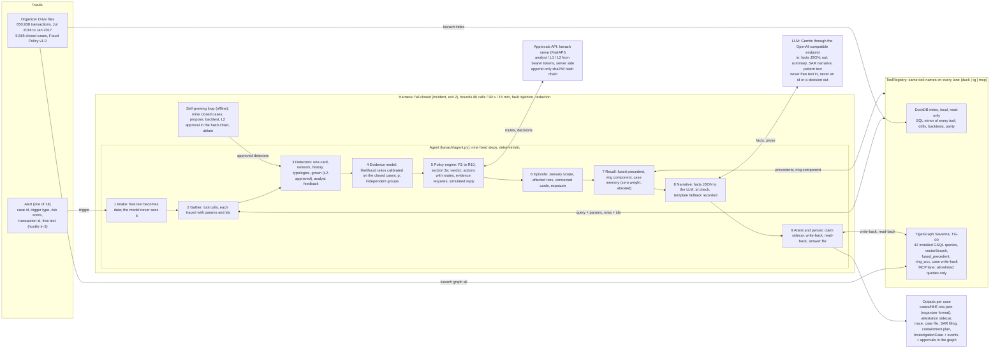

# Kavach architecture and sequence

One sentence: decisions come from tools and policy, the model only writes prose, and every claim in an answer can be re-run against the graph.

Two diagrams: the architecture (what the parts are and which ones talk) and the sequence (what happens, in order, for one alert). GitHub renders the Mermaid blocks; the same figures with a talk-through are published as a page for the mentoring sessions.

## 1. Architecture



Checks that run on the frozen answers (after the pipeline, not part of it): organizer grader 18 of 18 answered, hard 0, policy 0, warnings 0; `kavach attest --all` 0 failing claims; SAR filings verify 0 failed checks; `pytest` 356 passed; parity 18 of 18 across lanes (330 of 330 identical tool outputs); the same case twice gives identical decisions; a clean clone builds everything from nothing with `run_case.ps1` and exits 0.

## 2. Sequence: one alert, start to finish

```mermaid
sequenceDiagram
  autonumber
  participant A as Alert source (analyst, CLI or POST /alerts)
  participant G as Agent (kavach/agent.py)
  participant T as Graph tools (TigerGraph or the DuckDB mirror)
  participant P as Policy engine (policy.py: R1 to R10, section 3a)
  participant L as LLM (Gemini, prose only)
  participant R as Records (answer, sidecar, trace, case file)
  A->>G: alert: case id, trigger type, risk score, txn id, free text (treated as data)
  Note over G: 1 intake: free text redacted, quoted, zero weight; the model never sees it
  G->>T: 2 gather: card history, neighbourhood, entities, closed cases (installed queries)
  T-->>G: rows + ids; each call traced with its parameters
  Note over G,T: if the graph or a tool fails: one retry, then an incident record, exit 2, no answer
  Note over G: 3 detectors (one-card, network, history, typologies, grown, feedback); 4 evidence model (calibrated LRs, p, independent groups)
  G->>P: 5 signals, p, evidence groups, exposure
  P-->>G: verdict, initial actions with routes (auto, L1, L2), evidence requests
  Note over G: simulated reply (assumption stated), then final actions; 6 episode: January scope, affected txns, connected cards, exposure
  G->>T: 7 recall: fused_precedent (traversal + vectorSearch), ring_wcc, case memory
  T-->>G: precedents, ring component (zero weight, attested)
  G->>L: 8 facts JSON: anonymised ids, amounts, dates, chosen actions (never free text)
  L-->>G: summary, SAR narrative, pattern description; every id checked against the facts
  Note over G,L: if the model times out or returns garbage: template prose, fallback recorded, decisions unchanged
  Note over G: 9 attest: each claim = what, evidence ids, how (query + params), when (dataset version)
  G->>T: write-back: InvestigationCase + edges, case events, approvals, detector hits
  T-->>G: read back and compared; only then written_to_graph = true
  G->>R: answer cases/HHF-xxx.json, attestation sidecar, trace, case file; L1 and L2 approvals pending in the hash chain
```

## 3. Talk-through (about 90 seconds per diagram)

Architecture, left to right:
1. The alert: a case id, what triggered it, the transaction, free text. Six of the eighteen carry hostile text, so step one turns the text into data; the model never sees it.
2. The agent: nine fixed steps in the same order every time. Detectors, an evidence model calibrated on the bank's 5,585 closed cases, a policy engine that encodes R1 to R10 and section 3a. Run it twice, same answer.
3. The tool registry: one name, two implementations. TigerGraph with 42 installed queries, vector search over the closed-case notes, a fused query that walks the graph and then ranks by vector, and a connected-components query; a local DuckDB mirror for drills and backtests. Parity: 18 of 18 identical decisions.
4. The model: prose from a facts JSON, every id checked, template on failure, recorded. It cannot change a decision.
5. The dashed border: if the graph, a tool or a bound fails, the run stops with an incident and exit 2. Nothing is claimed as saved unless it was read back.
6. The loop at the bottom: the agent mines the closed cases, proposes a detector, backtests it and waits for an L2 approval in the same hash chain as every other approval. One approved detector changed HHF-006 and nothing else.
7. Outputs: the answer in the organizer format, the attestation sidecar, the trace, the case file, the SAR filing and containment plan, and the case written into the graph.

Sequence, top to bottom: alert and intake; gather (traced calls, one retry then incident); decide (detectors, evidence model, policy, simulated reply stated in the answer); recall (fused precedent and the ring, zero weight and attested); prose (facts in, text out, ids checked); attest, write back, read back, answer.

## 4. Questions mentors ask

| Question | Answer |
|---|---|
| Why two lanes? | Resilience and proof: drills and backtests run without the cloud; parity across lanes proves the GSQL; `--backend duck` gives the same decision if Savanna is slow in the demo. |
| Where does TigerGraph matter beyond storage? | `fused_precedent` (traversal to a candidate set, then `vectorSearch` over exactly that set), `ring_wcc`, case memory through edges from earlier investigations, and the case life written back (CaseEvent, Approval, Detector, DETECTOR_HIT). |
| Is the decision reproducible? | No randomness in the decision path; every final run prints `rerun:identical` for all 18; `kavach attest` re-runs every claim on the lane it was recorded on, 0 failing. |
| What if the model is wrong or hijacked? | It cannot change a decision or an id; its text is id-checked; on failure the template is used and recorded; the hostile free text never reaches it (`python -m kavach.intake --attacks`). |
| How do you avoid harming a legitimate customer? | R1 (never block on one weak signal below 0.70); balanced evidence gives `uncertain` plus escalation; the nine legitimate cases get allow, verify, monitor, close and no case; Round 1 regression 19 of 20 with zero legitimate customers harmed. |
| Who can approve what? | Role from the bearer token on the server, never from the body; wrong role gets 403 and a denied record; append-only hash chain verified by `GET /approvals/verify` and written to the graph. |
| Weakest point? | Simulated customer and analyst replies (stated in every answer); January has no labels, so some templates carry a stated coordination weight instead of a backtest; the grown-detector library is grid-bound and every new detector waits for a human L2. |
| Cost and size? | TG-00 with auto-suspend; 13 to 40 s per case with prose, about 15 tool calls; the whole pack re-runs in about 7 minutes. |
